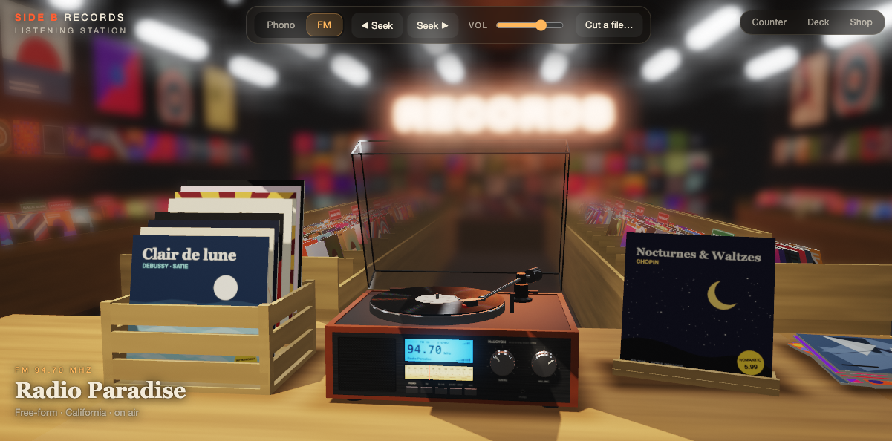

# Side B Records

[](assets/side-b-records.mp4)

*Click the picture to watch a one-minute demo ([`assets/side-b-records.mp4`](assets/side-b-records.mp4)). The video is silent; run the page to hear it.*

A record player simulated from the groove up, with an FM tuner, sitting on the counter of a record
shop. WebGL2 and Web Audio, plain ES modules, no dependencies and no build step.

It is a re-implementation of the idea behind [rauchg/vinyl](https://github.com/rauchg/vinyl): the
music is not played from a file. It is cut into a spiral groove, pressed with flaws, and read back
by a simulated stylus on the audio thread. This version puts that deck inside a three-in-one
"music centre" (turntable, radio, blue LCD, two fat knobs) and puts the music centre in a shop.

## Run it

```bash
npm run dev
```

Then open http://localhost:5173. Node 22+ is all it needs.

```bash
npm test
```

runs the offline checks of the groove chain: level, frequency response, pitch at 45 rpm, surface
noise, cueing, lead-in landings, skips, the locked groove, and CPU cost.

## Using it

| | |
|---|---|
| Crate (left) | Hover to pull a sleeve up, click to put it on. Each record is fetched, cut and pressed when you pick it. |
| Tonearm | Drag it over the record and let go. Dragging it in starts the platter; parking it stops it. |
| Record | Drag to spin it by hand, either way. |
| Tuning knob, dial | Drag, scroll, or click the scale. Between stations there is only static. |
| Stations… (FM) | The dial comes with eighteen stations. Remove any, or add another by its stream address and frequency; your dial is printed on the tuning scale and saved in your browser. |
| Volume knob | Drag or scroll. |
| Front buttons | PHONO, FM, 33/45, START·STOP, CUE. The same controls are in the bar at the top of the screen. |
| Dust cover | Click to close or open. |
| Cabinet | Double-click to knock it. The needle may jump. |
| Empty space | Drag to look around, scroll to zoom. |
| Cut a file… | Or drop an audio file anywhere: the lathe cuts it to a side and it goes in the crate as *Your Record*. |

Keys: `Space` start/stop · `C` cue · `S` speed · `K` knock · `P` phono · `F` radio · `←` `→` tune
(`Shift` seeks the next station) · `↑` `↓` volume · `1`–`9` records · `L` lid.

## How it works

**Fetch.** The crate ([`src/audio/records.js`](src/audio/records.js)) lists recordings that are
public domain or freely licensed. Their audio is in [`records/`](records) as MP3; picking a sleeve
fetches and decodes its tracks.

**Cut.** [`src/audio/cut.js`](src/audio/cut.js) is the lathe. It applies the RIAA cutting curve,
sums the bass to mono, limits wall acceleration, integrates to wall displacement for the two walls
of a 45/45 stereo groove, and lays out the spiral with variable pitch.

**Press.** [`src/audio/press.js`](src/audio/press.js) changes the geometry: wall roughness, dust,
scratches, warp, an off-centre hole. Nothing in it is an audio effect. Each record in the crate
has a condition, from mint to well played, and the same cut pressed in a worse condition sounds it.

**Play.** [`src/audio/engine-core.js`](src/audio/engine-core.js) runs in an `AudioWorklet`: a
platter with inertia, a tonearm on a pivot, and a round stylus tip resting on the pressed walls.
The output is the velocity of the tip relative to the cartridge body, through the RIAA playback
curve. Tracing distortion, duller treble near the label, wow from the off-centre hole, the arm's
10 Hz resonance, skips, the run-out groove and scratching by hand all fall out of that.

**Tune.** [`src/audio/radio.js`](src/audio/radio.js) is the tuner. Stations are internet streams
placed along an FM dial; signal strength falls off either side of each one into static. Eighteen
are on the dial to begin with, and you can change them (see below).

**Draw.** [`src/gl/`](src/gl) is a small WebGL2 renderer: a shadow map over the counter, HDR with
MSAA, depth of field for the shop behind, bloom for the tubes and the neon.
[`src/scene/`](src/scene) builds the shop, the unit and the crate, and draws every sleeve, label
and sign with canvas 2D. The disc is drawn from the cut itself: the real spiral, lit by how loud
each turn is.

## The records

Eight classical records, all from [Wikimedia Commons](https://commons.wikimedia.org) and all in the
public domain (one Chopin waltz is CC0). The source page of every file is in
[`records/README.md`](records/README.md) and in [`src/audio/records.js`](src/audio/records.js).

| Record | Tracks | Performer |
|---|---|---|
| *Clair de lune* | Debussy, *Clair de lune* · Satie, *Gymnopédie No. 1* | Laurens Goedhart · Robin Alciatore (Musopen) |
| *Peer Gynt Suite No. 1* | Grieg, *Morning Mood* · *In the Hall of the Mountain King* | Musopen Symphony |
| *Moonlight Sonata* | Beethoven, *Moonlight Sonata* (I) · Bach, *Air on the G String* | Paul Pitman (Musopen) · U.S. Air Force Strings |
| *Symphony No. 5* | Beethoven, Symphony No. 5 (I) | Fulda Symphonic Orchestra |
| *Nocturnes & Waltzes* | Chopin, Nocturne Op. 9 No. 2 · Waltz Op. 64 No. 2 | Frank Lévy (Musopen) · uncredited |
| *Toccata and Fugue* | Bach, Toccata and Fugue in D minor | Ashtar Moïra, organ |
| *Eine kleine Nachtmusik* | Mozart, *Eine kleine Nachtmusik* (Allegro) · *Rondo alla Turca* | via the European Archive · uncredited |
| *Waltz of the Flowers* | Tchaikovsky, *Waltz of the Flowers* | The U.S. Army Band |

The files were converted to MP3 and are otherwise unchanged; the lathe trims the silence at either
end of a track when it cuts. To add a record, drop MP3s in `records/` and add an entry to
`records.js`.

## Radio stations

The dial starts with eighteen stations.

| MHz | Station | From | What |
|---|---|---|---|
| 88.5 | [FIP](https://www.radiofrance.fr/fip) | Paris | Eclectic |
| 90.3 | [KEXP](https://kexp.org) | Seattle | Indie |
| 91.3 | [Javeriana Estéreo](https://www.javerianaestereo.com) | Bogotá | Culture & classical |
| 92.1 | FIP Jazz | Paris | Jazz |
| 93.5 | [La Kalle](https://lakalle.bluradio.com) | Bogotá | Vallenato & popular |
| 94.7 | [Radio Paradise](https://radioparadise.com) | California | Free-form |
| 95.9 | [Radio Nacional de Colombia](https://www.radionacional.co) (RTVC) | Bogotá | Public radio |
| 96.9 | FIP Groove | Paris | Funk & soul |
| 97.7 | [Caracol Radio](https://caracol.com.co) | Bogotá | News & talk |
| 98.5 | RP Mellow | California | Mellow |
| 99.1 | [Radiónica](https://www.radionica.rocks) (RTVC) | Bogotá | Alternative |
| 100.7 | [NTS](https://nts.live) 1 | London | Underground |
| 102.3 | France Musique | Paris | Classical |
| 102.9 | [Tropicana](https://www.tropicanafm.com) | Bogotá | Tropical & salsa |
| 104.5 | RP Rock | California | Rock |
| 105.3 | [Univalle Estéreo](https://www.univalle.edu.co) | Cali | University & culture |
| 106.1 | FIP World | Paris | World |
| 107.3 | JZR Swing | Geneva | Electro swing |

The Colombian stations sit on their real Bogotá or Cali frequency where the dial has room
(Radio Nacional, Radiónica, Tropicana, Univalle Estéreo) and nearby where it does not.
Radio Nacional and Radiónica only stream over plain `http`, so they play when you run the page
locally (`npm run dev`) but a browser blocks them on a page served over `https`.

If you changed your dial before these were added, **Restore presets** puts the new ones on it.

In FM mode, **Stations…** lets you remove any of them, add the direct stream address (MP3 or AAC
over `https`) of another with a name and a frequency between 87.5 and 108 MHz, and put the
originals back. Your dial lives in your browser's local storage and is never sent anywhere.

A stream belongs to the station that broadcasts it. The page connects your browser directly to
the station's own address; it does not record, host or relay anything. The stations have not
endorsed this project: if you run it publicly, check their terms or ask them, and take a station
off the list in [`src/audio/radio.js`](src/audio/radio.js) if it asks you to.

## Credits

- The idea, and the groove-up approach, come from [rauchg/vinyl](https://github.com/rauchg/vinyl) (MIT).
- Radio: the stations listed above. Their streams and names are theirs.
- Recordings: see the table above.

## License

The code is [MIT](LICENSE). The recordings in `records/` are not covered by it: they keep the
licences of their sources, listed in [`records/README.md`](records/README.md).
